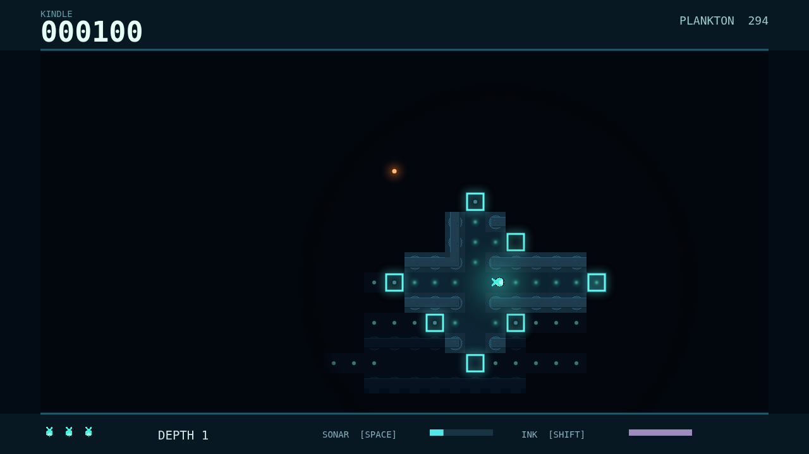

# Fathom

A tiny forager lights a sliver of ocean floor. Follow the glow through narrow trenches, graze on plankton, and clear the maze to descend deeper. Each bite brightens your body and widens the circle of water you can see.

The dark remembers what you have found, but it will not show it from afar. Send a sonar pulse around corners to sketch the corridors ahead, then swim into the unknown to bring them back into view. Ink gives you a brief escape when a light hunter closes in.

Three hunters share the trench. The Lanternjaw's warm bulb could be a harmless drifting meal. The eyeless Gloamfin answers sound with its own violet ping. The Flarefish lights up a wide patch of abyss before it strikes. Learn their tells, hold your nerve, and keep moving.

